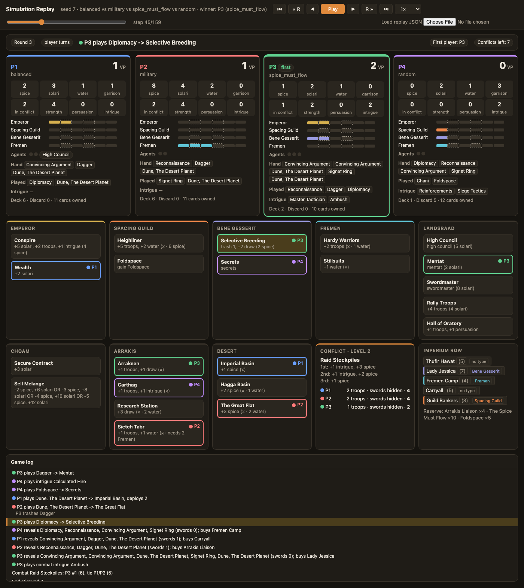

# Agent Project Definition and Proof of Concept

**Project:** A strategy-testing agent for the board game *Dune: Imperium*

| | |
|---|---|
| Name | Jonny Lightheart |
| Repository | https://github.com/jlightheart24/dune-imperium-simulator |
| Submitted commit | COMMIT_HASH_IN_PDF |
| Date | November 11, 2026 |

---

## 1. Problem, user, intended use, target outcome

**Problem.** *Dune: Imperium* is a four-player game that mixes worker placement, deck
building and combat. With its complexity and layers, this game is far from solved. A
single game takes about two hours, so playing enough games at a table to separate a good
strategy from good luck is not practical. As an avid player myself, I will seek to show
which strategies work, and against which opponents, by developing heuristic agents that
test a wide variety of strategies.

**Intended user.** Myself and other players who want evidence about which strategic
approach performs best.

**Intended use.** The user picks a strategy (a built-in one, a set of weights in a JSON file,
or a Python class), runs it for hundreds of simulated games against a fixed reference
agent, and reads a win rate with a confidence interval. Individual games can be replayed
step by step to see *why* a strategy won or lost.

**Target outcome.**

1. An agent that plays complete, legal games and clearly beats a random player.
2. A repeatable evaluation that ranks strategy variants against a fixed baseline, with
   numerical uncertainty, so that "strategy A is better than B" is a supported statement.

## 2. PEAS analysis

| | |
|---|---|
| **Performance measure** | Primary: win rate in a four-player game against three copies of the baseline agent (fair share 25%), with a 95% Wilson confidence interval. Secondary: average victory points (VP), average finishing rank. Cost: CPU time per game. Reliability: share of games that finish legally, and identical results for an identical seed. |
| **Environment** | A simulated four-player game. **Partially observable** (deck order, opponents' hands and intrigue cards are hidden), **stochastic** (shuffles, card market refills, intrigue draws), **multi-agent and competitive**, **sequential** (about 40 decisions per player per game), **turn-based and discrete**, with **known rules**. |
| **Actuators** | On its turn the agent either (a) plays one card from hand to send an agent to a board space, or (b) reveals its remaining hand. Within those it also chooses: how many troops to deploy, which cards to buy, which faction to gain influence with, which card to trash, which branch of an either/or effect to take, and which intrigue cards to play. |
| **Sensors** | Its own hand, resources, troops, influence and deck contents; every player's public resources, influence, alliances and troops committed to the conflict; which board spaces are occupied; the current conflict card and its rewards; the five cards for sale; the round number and cards left in the conflict deck. |

## 3. Agent definition

**Decision boundary.** The agent decides only its own moves. The engine owns everything
else: it lists the legal actions, applies card and board effects, resolves combat, refills
the market and scores the game. If an agent returns an illegal action the engine
substitutes a reveal turn, so a faulty agent cannot corrupt the game.

**Percepts.** At each decision point the agent is handed the current game state and the
list of legal options for that decision.

**Actions.** Eight decision points, each a method on the agent:

| Decision | Options offered |
|---|---|
| `choose_turn` | each legal (card, board space) pair, or reveal |
| `choose_deploy` | 0 to *n* troops into the conflict |
| `choose_purchase` | each affordable card, or stop buying |
| `choose_influence` | one of four factions |
| `choose_trash` | a card to remove, or none |
| `choose_option` | a branch of an either/or or optional effect |
| `choose_plot_intrigue` | an intrigue card to play on its turn, or none |
| `choose_combat_intrigue` | an intrigue card to play in combat, or none |

**State.** Per player: spice, solari, water, troops in garrison and in the conflict, VP,
influence on four factions, deck / hand / discard, intrigue cards, number of agents, High
Council seat. Shared: board occupancy, bonus spice on desert spaces, location control,
alliances, the card market, the conflict deck, round and first player.

**Goal and terminal condition.** The game ends after the round in which any player reaches
10 VP, or when the ten-card conflict deck runs out. The highest VP wins; ties are broken by
spice, then solari, then water, then garrison troops. The agent's goal is to finish first.

**Interaction loop.** Each round: reveal a conflict card, every player draws five cards,
players take turns until all have revealed, combat is resolved, unused desert spaces gain
spice, and agents are recalled.

## 4. AI strategy

**Selected strategy: a utility-based agent with one-step stochastic lookahead.**

For each legal turn the agent:

1. clones the game state, reshuffling every hidden deck in the clone so the lookahead
   cannot see information the agent should not have;
2. applies the candidate action in the clone, including any random card draws;
3. scores the resulting position with a weighted utility function;
4. plays the action with the highest score.

The utility function combines VP, resources valued by what they can still buy (solari and
spice lose value beyond what the remaining purchases need), influence with extra weight
near the scoring thresholds, deck quality, the persuasion and swords still in hand, extra
agents, and the expected reward from the current conflict given visible troop strengths.
Smaller decisions (troop deployment, purchases, trashing) use rules driven by the same
weights.

A *strategy* is a set of weights plus optional forced priorities. The project ships a
random agent and 17 weighted profiles (for example `military`, `alliances`, `thin_deck`,
`spice_must_flow`, one per faction, one per card type). The `balanced` profile is frozen as
the reference opponent.

**Why it fits.**

- The game has 20 to 30 legal turns at most decision points and about 160 turns per game,
  with hidden information and four players. Full-depth search is expensive, and the
  evaluation needs thousands of games to give tight confidence intervals. One-step
  lookahead costs roughly one CPU-second per game, which makes that affordable.
- Simulating each action on a clone means the agent automatically accounts for card and
  board effects without hand-written rules for each of them.
- Expressing strategies as weights lets a user state a hypothesis ("alliances matter more
  than combat") as a small change and test it directly.

**Principal technical uncertainty.** Whether a hand-weighted, one-step agent plays
coherently enough to be a meaningful opponent: it must (a) beat random play decisively and
(b) respond to its weights strongly enough that different strategies give measurably
different results. If it fails either, strategy comparisons built on it mean nothing. The
proof of concept tests both (section 8).

**Planned comparison.** In the week ending November 19 a second agent using Monte Carlo
rollouts (playing each candidate action forward to the end of the round or game several
times with the baseline policy) will be compared with the one-step agent on win rate and
CPU cost, to measure what deeper search buys.

## 5. System diagram

```
  strategies (weights / JSON / Python class)          game data (board, cards,
                 |                                     conflicts, intrigue)
                 v                                              |
        +-------------------+    legal options, state           v
        |   AGENT (x4)      | <----------------------- +------------------+
        |                   |                          |   RULES ENGINE   |
        |  for each option: |    chosen action         |                  |
        |   clone + apply   | -----------------------> |  turns, effects, |
        |   score utility   |                          |  combat, scoring |
        |   pick the best   | <---- clone of state --- |                  |
        +-------------------+      (hidden decks       +------------------+
                                    reshuffled)           |            |
                                                          | results    | frames
                                                          v            v
                        +---------------------------------------+   +----------------+
   seeds, matchups ---> |  EVALUATION HARNESS (batch, benchmark) |   | REPLAY VIEWER  |
                        |  win %, 95% CI, VP, rank, economy      |   | step through   |
                        +---------------------------------------+   | one game       |
                                          |                         +----------------+
                                          v
                        results/<name>/ summary.txt, results.json, games.csv
```

| Component | File |
|---|---|
| Game data and effect language | `dune_sim/data.py` |
| Rules engine, replay frames | `dune_sim/engine.py` |
| Agent interface, random agent, utility agent, profiles | `dune_sim/strategies.py` |
| Evaluation harness and command line | `dune_sim/cli.py` |
| Replay viewer | `viewer/viewer.html` |
| Repeatability and sanity tests | `tests/test_repeatable.py` |

## 6. Schedule

| Period | Scope | Status |
|---|---|---|
| Through Nov 12 | Rules engine; random and utility agents; 17 strategy profiles; batch evaluation with confidence intervals; saved, repeatable runs; replay viewer; this definition | Done |
| Week ending Nov 19 | Monte Carlo rollout agent and comparison with the one-step agent; check card data against the physical game and correct it; leader abilities if time allows; final benchmark at 1,000 games per matchup | Planned |
| Thanksgiving week | No submission | |
| Final week (to Dec 3) | Limited refinement, final report, presentation slides | Planned |

## 7. Evaluation plan

**Protocol.** One command runs every strategy in one seat against three copies of the
baseline and saves the output:

```
python3 -m dune_sim benchmark -n 400 --seed 1 --save <name>
```

- Each matchup uses the same seeds (1 to *n*). Seating is shuffled per game from the seed,
  so seat order does not favour any strategy.
- A game is fully determined by its seed and the strategies; the unit tests check that the
  same seed gives the same game, including when run across several processes.
- Every saved run records the exact command, date, Python version, git commit, per-strategy
  statistics and one CSV row per player per game.

**Measures.**

| Property | Measure |
|---|---|
| Solution quality | Win rate vs. three baselines with 95% Wilson interval; average VP with standard error; average rank |
| Decision rule | "Better" or "worse" than baseline only when the interval excludes the 25% fair share; otherwise "no clear difference" |
| Cost | CPU-seconds per game |
| Reliability | Share of games completing legally (target 100%); unit tests passing; identical output for identical seed |
| Behaviour check | Economy and conflict statistics per round (`--detail`), to confirm a strategy does what it claims |

**Sample size.** At 400 games a 25% win rate has an interval of about ±4 points; the final
benchmark will use 1,000 games (about ±2.7 points).

## 8. Proof of concept

### Run instructions

Requires Python 3.9 or later; no packages to install.

```
git clone https://github.com/jlightheart24/dune-imperium-simulator.git && cd dune-imperium-simulator

# 7 repeatability and sanity tests, about 1 minute
python3 -m unittest

# Evidence 1: the agent against random play
python3 -m dune_sim batch -n 200 -p balanced random random random \
    --save poc_balanced_vs_random

# Evidence 2: four identical agents
python3 -m dune_sim batch -n 400 --fixed-seats --detail \
    -p balanced balanced balanced balanced --save balanced_mirror

# Evidence 3: every strategy against the baseline (about 25 minutes)
python3 -m dune_sim benchmark -n 200 --save benchmark_v1

# Evidence 4: one game as a step-by-step replay
python3 -m dune_sim watch -p balanced military spice_must_flow random \
    --seed 7 -o results/poc_replay_seed7.html
```

### What it demonstrates

- **Representative input:** four strategy names and a seed define the initial state.
- **Executes the AI strategy:** every turn of every game is chosen by the lookahead agent.
- **Observable result:** a win-rate table, and a step-by-step replay of any single game.
- **Retained evidence:** the `results/` folder in the repository holds the output below.

### Evidence 1: the agent against random play

`results/poc_balanced_vs_random/summary.txt` (200 games, one `balanced` vs. three `random`):

```
strategy      win %        95% CI   avg VP  avg rank
balanced     100.0%    98.1-100.0    11.04      1.00
random         0.0%       0.0-0.6     2.77      3.00
```

### Evidence 2: four identical agents

`results/balanced_mirror/summary.txt` (400 games, fixed seats):

```
strategy      win %        95% CI   avg VP  avg rank
balanced      25.0%     22.9-27.2     7.55      2.50
win % by seat: P1 21.5%, P2 24.5%, P3 27.0%, P4 27.0%
```

Identical agents split wins evenly, and no seat's share is far from 25%, so the harness is
not biased toward a seat. Games averaged 9.7 rounds.

### Evidence 3: every strategy against the baseline

`results/benchmark_v1/summary.txt` (200 games per strategy, one seat vs. three `balanced`):

```
strategy                       win %        95% CI   avg VP  +/-SE  base VP  avg rank  verdict
----------------------------------------------------------------------------------------------
random                          0.0%       0.0-1.9     2.23   0.09     8.31      3.99  worse than baseline
legacy                          9.0%      5.8-13.8     5.74   0.16     8.00      3.25  worse than baseline
military                       19.5%     14.6-25.5     6.74   0.15     7.62      2.76  no clear difference
spice                          21.0%     15.9-27.2     6.78   0.17     7.68      2.78  no clear difference
factions                       28.0%     22.2-34.6     7.76   0.16     7.51      2.46  no clear difference
fremen_faction                  9.0%      5.8-13.8     5.87   0.14     7.86      3.21  worse than baseline
deckbuilder                    27.0%     21.3-33.5     7.96   0.16     7.60      2.42  no clear difference
thin_deck                      18.0%     13.3-23.9     7.23   0.14     7.56      2.68  worse than baseline
spice_must_flow                20.0%     15.0-26.1     7.32   0.16     7.78      2.67  no clear difference
emperor_faction                30.0%     24.1-36.7     7.40   0.16     7.31      2.45  no clear difference
guild_faction                  20.0%     15.0-26.1     7.24   0.15     7.58      2.67  no clear difference
bene_gesserit_faction          31.5%     25.5-38.2     7.96   0.15     7.31      2.26  better than baseline
alliances                      28.5%     22.7-35.1     7.75   0.17     7.41      2.42  no clear difference
emperor_cards                  20.0%     15.0-26.1     7.29   0.16     7.57      2.64  no clear difference
guild_cards                    21.0%     15.9-27.2     7.20   0.16     7.62      2.67  no clear difference
bene_gesserit_cards            19.0%     14.2-25.0     7.20   0.15     7.64      2.65  no clear difference
fremen_cards                   22.0%     16.8-28.2     6.91   0.17     7.67      2.73  no clear difference
```

Fair share is 25%. A verdict of "better" or "worse" means the 95% interval excludes 25%.

- **Clearly worse:** `random` (0%), `legacy` (9.0%), `fremen_faction` (9.0%) and `thin_deck` (18.0%).
- **Clearly better:** `bene_gesserit_faction` (31.5%, interval 25.5 to 38.2), though only just.
- **Not separated from the baseline at 200 games:** the other twelve, ranging from 19.0% to 30.0%.

Win rates span 9% to 31.5% across the weighted strategies, so the weights do change
outcomes, but 200 games is too few to rank the middle of the field. The final benchmark
will use 1,000 games per matchup.

### Evidence 4: a single game trace

`results/poc_replay_seed7.html` is a self-contained replay of seed 7 (159 steps):
`spice_must_flow` won with 11 VP over `military` 8, `balanced` 6 and `random` 2. It shows
every action, the board, and each player's resources at every step.



### Evidence 5: tests

`python3 -m unittest` runs 7 tests (same seed gives the same game; different seeds differ;
worker count does not change results; games end within ten rounds; every profile completes
a game; the baseline beats random; the confidence interval is computed correctly). All pass.

## 9. Feasibility assessment

**The direction is feasible.** The principal uncertainty had two parts:

- *Does the agent beat random decisively?* Yes: 200 wins from 200 games (95% interval
  98.1% to 100%).
- *Do different weights give measurably different play?* Partly. Across 16 weighted
  strategies, win rates against the baseline ran from 9.0% to 31.5%. Four strategies were
  separated from the baseline at the 95% level (three worse, one better); twelve were not
  at 200 games. The weights clearly matter, but separating strategies that are close needs
  larger samples, which the harness can run.

All games completed legally, runs are repeatable from their seed, and the cost is low
enough to run thousands of games on a laptop.

**What must change next.**

1. The baseline is only a one-step agent. Adding the Monte Carlo rollout agent will show
   whether the strategy rankings hold against a stronger player.
2. Card effects for the market deck, conflict rewards and intrigue cards are simplified
   approximations. They need checking against the physical game before the rankings can be
   read as statements about the real game.
3. Mirror games usually last the full ten rounds, which suggests the agent is slow to
   convert a strong position into points late in the game.

## 10. Limitations, failure conditions, recommendation criteria

**Limitations.**

- Leaders and their abilities, the two-player rules and the expansions are not modelled.
- Some card effects that target opponents are reduced to their effect on the owner.
- The agent looks one step ahead and does not model what opponents will do next, beyond a
  fixed allowance for hidden combat strength.
- Hidden information is protected in the lookahead by reshuffling, but the agent interface
  passes the whole game state, so a custom agent could read opponents' hands. The built-in
  agents do not.
- Results describe play against this baseline, not against skilled human players.

**Failure conditions.** The approach should be considered failed if the baseline cannot
beat random play, if the same seed gives different results, if no strategy can be
separated from the baseline at 1,000 games, or if correcting the card data reverses most of
the rankings (which would mean the conclusions depended on the approximations).

**Recommendation criteria for the final report.**

| Recommendation | Criteria |
|---|---|
| **Deploy** as a strategy-testing tool | Baseline beats random in at least 95% of games; results reproduce from seeds; at least one strategy is separated from the baseline with a 95% interval; card data verified against the physical game; rankings broadly hold against the rollout agent |
| **Revise** | The tool is reliable and repeatable, but rankings change materially when card data is corrected or when the opponent is the rollout agent |
| **Do not use** | The baseline fails against random, results do not reproduce, or no strategy difference is detectable at 1,000 games |
