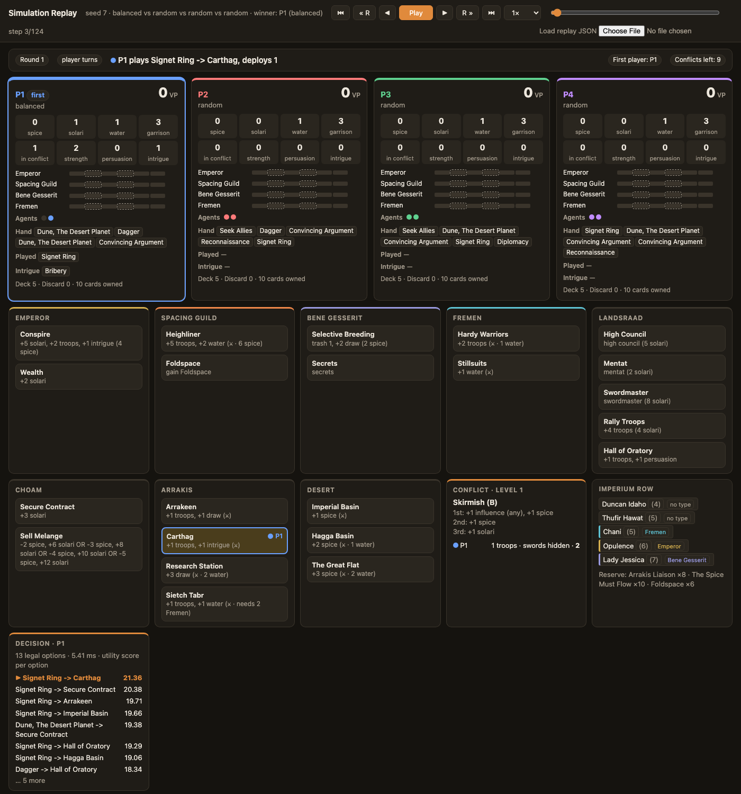

# Agent Project Vertical Slice

**Project:** A strategy-testing agent for the board game *Dune: Imperium*

| | |
|---|---|
| Name | Jonny Lightheart |
| Repository | https://github.com/jlightheart24/dune-imperium-simulator |
| Submitted commit | COMMIT_HASH_IN_PDF |
| Date | November 11, 2026 |

---

## 1. What this checkpoint shows

One complete path through the system: a set of players and a seed go in, the agent chooses
every one of its turns with the approved AI strategy, the environment applies each action,
and the game reaches an explicit terminal condition with a winner. Every turn decision is
recorded with what the agent saw, what it could do, how it scored each option, what it
chose, and what changed as a result.

## 2. Commands

**Setup.** Python 3.9 or later. No packages to install, no credentials, no network access.

```
git clone https://github.com/jlightheart24/dune-imperium-simulator.git
cd dune-imperium-simulator
```

**Tests** (14 automated tests, about 15 seconds):

```
python3 -m unittest
```

**Run the vertical slice** (one traced game; prints the full decision trace):

```
python3 -m dune_sim trace -p balanced random random random --seed 7
```

Add `--save NAME` to write `trace.txt`, `trace.json`, `result.json` and a step-through
`replay.html` to `results/NAME/`.

**Baseline measurement** (the seven retained cases, then the aggregate baseline):

```
python3 -m dune_sim cases
python3 -m dune_sim batch -n 200 --detail -p balanced balanced balanced balanced \
    --save results/vertical_slice/baseline_mirror
```

The cases are defined in `cases/vertical_slice.json`. Their raw results are retained in
`results/vertical_slice/`.

## 3. The implemented agent-environment path

```
 input: player strategies + seed
        |
        v
 ENGINE  sets up the game, then for each turn of each round:
        |
        |  1. lists the agent's legal options (card + board space pairs, or reveal)
        v
 AGENT   for each option: clone the state (hidden decks reshuffled), apply the option,
        |  score the resulting position with the weighted utility function
        |  2. returns the highest-scoring option
        v
 ENGINE  3. checks the action is legal (if not, or if the agent raised an error:
        |     substitutes a reveal turn, counts it and logs it)
        |  4. applies the action: costs, board and card effects, troop deployment
        |  5. records a frame: full state, the options with scores, the choice, timing
        v
 ... until any player has 10 VP at the end of a round, or the conflict deck runs out
        |
        v
 result: terminal status, winner, VP and rank per player, decision statistics
 evidence: trace.txt, trace.json, result.json, replay.html
```

| Requirement | Where it is met |
|---|---|
| Accepts a representative task and reaches a terminal condition | `trace`, `batch` and `cases` take strategies and a seed; every game ends with "10 VP reached" or "conflict deck exhausted" |
| Uses the approved AI strategy, not a hard-coded answer | `HeuristicStrategy.choose_turn` in `dune_sim/strategies.py` scores every legal option by one-step lookahead on each turn |
| Percepts, actions, state and effects are inspectable | `trace.txt` lists them per decision; `replay.html` shows the full state and a decision panel at every step |
| Records how the result was produced | Each frame stores the options, their scores, the chosen one, the decision time, and any rule or fallback that applied |
| Handles an expected failure explicitly | Faulty agents and unsupported input, described in section 5 |
| Agrees with the approved design | Section 4 lists the changes |

**How the agent's decisions are recorded.** At each turn the agent reports the utility
score it computed for every legal option. The engine stores them with the frame for that
action. When a strategy's forced-priority rule decides instead (for example, "always take
Swordmaster when affordable"), the frame records the rule and no scores.

## 4. Changes from the project definition (U0-HW-10)

The AI strategy, environment, agent interface and evaluation plan are unchanged. Four
additions and one correction:

| Change | Why |
|---|---|
| **Decision recording added.** The engine now stores each turn's options, scores, choice and timing. | The definition's replay showed what happened but not why. This checkpoint requires the agent's available actions and reasoning to be inspectable. |
| **Agent failures are handled explicitly.** An illegal action or an exception from an agent is replaced by a reveal turn, counted per player and written to the trace. | The definition said illegal actions were replaced, but this was silent and exceptions were not caught. A faulty custom strategy could crash a batch run. |
| **Input is validated before any game starts.** Unknown strategies and unsupported table sizes give a one-line error and exit code 2. | Previously these produced a Python traceback. |
| **New measures:** decisions per game, legal options per decision, time per decision, near-tie rate, fallbacks, and how the game ended. | Needed for the baseline, and the near-tie rate motivates the next change (section 8). |
| **Correction.** The definition said mirror games "usually last the full ten rounds". Measured: games average 9.7 rounds, but 75% end because a player reached 10 VP and only 25% because the conflict deck ran out. | The earlier statement was inferred from game length alone. The end reason is now recorded directly. |

## 5. Failure handling

Three kinds of failure are handled, each with a retained case and an automated test.

**A faulty agent (case c5).** `dune_sim/faulty.py` defines an agent that returns an
illegal action on every third turn and raises an exception on every fifth. The engine
replaces each fault with a reveal turn, which is always legal, and the game completes.
From `results/vertical_slice/c5_failure_faulty_agent/trace.txt`:

```
  options  : 7 legal, decided in 0.0 ms
            n/a  Test of Humanity -> Secrets
            n/a  Test of Humanity -> Hall of Oratory
            n/a  Dune, The Desert Planet -> Secure Contract
            n/a  Dune, The Desert Planet -> Sell Melange
            n/a  Dune, The Desert Planet -> Imperial Basin
            n/a  Dune, The Desert Planet -> Hagga Basin
         ... 1 more
  FALLBACK : agent error RuntimeError: simulated agent crash -> replaced by a reveal turn
```

Six faults were contained in that game. The three baseline agents at the same table
recorded zero fallbacks, and the game ended normally.

**Unsupported input (cases c6 and c7).** Checked before any game runs:

```
$ python3 -m dune_sim batch -n 5 -p balanced no_such_strategy random random
error: unknown or unloadable strategy 'no_such_strategy' (unknown strategy 'no_such_strategy').
Run `python3 -m dune_sim list` to see the built-in names
(exit code 2)

$ python3 -m dune_sim batch -n 5 -p balanced balanced balanced balanced balanced
error: unsupported table size: 5 players given, the game supports 2 to 4
(exit code 2)
```

**An unsuccessful outcome (case c3).** The agent plays a complete legal game and loses.
This is reported as "success condition not met", not as an error.

## 6. Baseline measurement

**Task-specific success condition:** the agent under test (seat 1) finishes first.

### Retained cases

Command: `python3 -m dune_sim cases` (inputs in `cases/vertical_slice.json`, all seed 7).

| Case | Kind | Players | Terminal status | Success condition | VP | Rank | Turn decisions | Options per decision | ms per decision | Near-ties | Fallbacks |
|---|---|---|---|---|---|---|---|---|---|---|---|
| c1 | Supported | `balanced` vs 3 `random` | 10 VP reached, round 8 | **Met** | 10 | 1 | 16 | 13.7 | 5.65 | 40.0% | 0 |
| c2 | Supported | `bene_gesserit_faction` vs 3 `balanced` | Conflict deck exhausted, round 10 | **Met** | 8 | 1 | 27 | 13.8 | 6.79 | 29.6% | 0 |
| c3 | Unsuccessful | `fremen_faction` vs 3 `balanced` | 10 VP reached, round 9 | **Not met** | 4 | 4 | 19 | 16.2 | 8.43 | 26.3% | 0 |
| c4 | Boundary | `balanced` vs `balanced` (2 players) | 10 VP reached, round 9 | **Met** | 10 | 1 | 20 | 16.1 | 6.35 | 31.6% | 0 |
| c5 | Failure handling | `FaultyAgent` vs 3 `balanced` | 10 VP reached, round 10 | **Not met** | 2 | 4 | 14 | 12.5 | 0.0 | n/a | 6 |
| c6 | Unsupported input | unknown strategy name | Rejected, exit code 2, no game | Not applicable | | | | | | | |
| c7 | Unsupported input | 5 players | Rejected, exit code 2, no game | Not applicable | | | | | | | |

All seven cases behaved as their definition expected. Notes on reading the table:

- **Turn decisions** counts turns where the agent had more than one legal option.
- **Near-ties** is the share of scored decisions where the best and second-best options
  were within 0.5 utility points. One VP is worth 10 points, so that is 1/20 of a VP.
- **ms per decision** is wall-clock time and varies between machines and runs. Every other
  column is identical on every run of the same command.
- c5's agent is random apart from its faults, so it reports no scores.

### Aggregate baseline

Command: `python3 -m dune_sim batch -n 200 --detail -p balanced balanced balanced balanced --save results/vertical_slice/baseline_mirror`

| Measure | Baseline value (200 games, 800 player-games) |
|---|---|
| Win rate per seat | 25.0% (95% interval 22.1 to 28.1) |
| Average VP | 7.48 |
| Games ended by a player reaching 10 VP | 75% |
| Games ended by the conflict deck running out | 25% |
| Turn decisions per player per game | 23.0 |
| Legal options per decision | 13.6 |
| Time per decision | 14.6 ms (with all CPU cores busy) |
| Near-tie decisions | 38% of scored decisions |
| Fallbacks per game | 0.00 |
| Games completing legally | 200 of 200 |

## 7. Selected execution evidence

**One decision from case c1**, from `results/vertical_slice/c1_supported_vs_random/trace.txt`.
It shows the percepts, the legal options with their utility scores, the choice, and the
effect on the environment:

```
[step 3] round 1
  percepts : vp 0, spice 0, solari 0, water 1, garrison 3, conflict 0, persuasion 0, agents left 2
             influence: emperor 0, guild 0, bene_gesserit 0, fremen 0
             hand: Dune, The Desert Planet, Dagger, Dune, The Desert Planet, Signet Ring, Convincing
                   Argument
             occupied spaces: none
  options  : 13 legal, decided in 5.12 ms
      >>   21.36  Signet Ring -> Carthag
           20.38  Signet Ring -> Secure Contract
           19.71  Signet Ring -> Arrakeen
           19.66  Signet Ring -> Imperial Basin
           19.38  Dune, The Desert Planet -> Secure Contract
           19.29  Signet Ring -> Hall of Oratory
         ... 7 more
  action   : P1 plays Signet Ring -> Carthag, deploys 1
  effect   : solari +1, conflict +1
```

**The same decision in the replay viewer**
(`results/vertical_slice/c1_supported_vs_random/replay.html`, step 3). The decision panel
is at the bottom left; the board shows the agent placed on Carthag.



**Unsuccessful outcome, case c3**, last line of its trace:

```
RESULT: 10 VP reached after 9 rounds; P1 [fremen_faction] 4 VP (rank 4), P2 [balanced] 6 VP
(rank 3), P3 [balanced] 10 VP (rank 1), P4 [balanced] 8 VP (rank 2)
```

**Retained files** in `results/vertical_slice/`:

| File | Contents |
|---|---|
| `cases.md`, `cases.json` | The case table and raw per-case measures, with the command, date, Python version and commit |
| `c1` to `c5` folders | `trace.txt` (readable decision trace), `trace.json` (every frame's decision data), `result.json`, `replay.html` |
| `c6`, `c7` folders | `error.txt` with the rejection message |
| `baseline_mirror/` | `summary.txt`, `results.json`, and `games.csv` with one row per player per game |

## 8. Evidence-based change for the next checkpoint

**Finding.** In 38% of scored turn decisions, the agent's best and second-best options were
within 0.5 utility points of each other (26% to 40% across the individual cases). At that
margin the one-step evaluation is effectively guessing: the choice depends on small
differences in hand-set weights, not on what happens next in the round.

**Change.** Add Monte Carlo rollouts for near-tie decisions. When the top options are
within the near-tie margin, play each one forward to the end of the round several times,
using the baseline policy for all players, and choose the option with the best average
result. Decisions that are not near-ties keep the one-step choice, which limits the cost.

**How it will be judged against this baseline.**

| Measure | Baseline | Target for the change |
|---|---|---|
| Win rate vs. three `balanced` (400 games) | 25.0% by definition | 95% interval above 25% |
| Time per decision | 14.6 ms | Reported; expected to rise |
| Fallbacks | 0 | 0 |

If the rollout agent does not beat the baseline, that is evidence the weights, not the
search depth, limit the agent, and the final report will say so.

## 9. Current omissions and known failures

**Omissions.**

- Only the turn choice is scored and traced. Smaller decisions (how many troops to deploy,
  which cards to buy, which card to trash, intrigue cards) are rule-based and appear in the
  trace only through their effects.
- The readable `trace.txt` follows one seat. All seats' decisions are in `trace.json` and
  the replay.
- Leaders and their abilities, the official two-player rules and the expansions are not
  modelled. Case c4 uses the normal rules with two seats.
- Market cards, conflict rewards and intrigue cards use simplified effects that still need
  checking against the physical game.

**Known failures and weaknesses.**

- `fremen_faction` loses consistently to the baseline (9% win rate over 200 games in the
  project definition's benchmark; rank 4 in case c3).
- The fallback catches every exception from an agent. That keeps runs alive, but it could
  hide a bug in a custom strategy. Fallbacks are counted and reported so this is visible,
  and a test asserts the built-in agents record none.
- Time per decision is not repeatable between machines, so it is a rough cost measure only.
- The agent interface passes the whole game state. The built-in agents use only public
  information and their own hand, but the interface does not enforce that.
